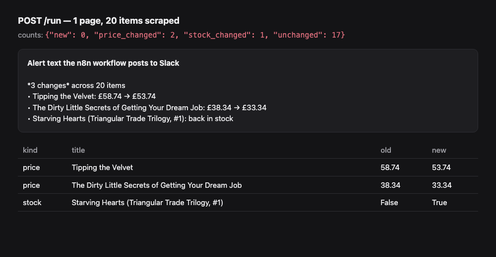

# Scraper + Automation Demo — price & stock alerts

A scraper that keeps working when websites change, stores price history, and tells you **only what changed**, delivered to Slack every morning by an n8n workflow.



*A real `/run` against books.toscrape.com; to show alerts, a few stored prices and stock flags were edited first so the scraper detects them as changes.*

Target: [books.toscrape.com](https://books.toscrape.com), a public sandbox built for scraping practice. The same pattern runs in production for shipping-line container tracking.

```
n8n (8am daily) ──POST /run──▶ FastAPI ──▶ scraper ──▶ SQLite (items + change history)
       │                                                        │
       └──── IF changes > 0 ──▶ format ──▶ Slack  ◀── changes ──┘
```

## Why it doesn't break easily
- **Fallback selectors** for every field: a redesign with new CSS classes still parses (there's a test for it).
- **Retries with backoff** on timeouts, 429 and 5xx; polite delay between requests; honest User-Agent.
- **Validation:** cards missing a title or price are reported in `problems`, never saved as bad data.
- **Change detection:** price and stock changes are stored with timestamps, so alerts contain only what's new.

## Run it

```bash
python3 -m venv .venv && .venv/bin/pip install -r requirements.txt
.venv/bin/python -m scraper --pages 3 --csv books.csv     # one-off run + CSV export
.venv/bin/uvicorn scraper.api:app --reload                # API for n8n
```

With n8n: `cp .env.example .env && docker compose up`, open http://localhost:5678, import `n8n/price-alert-workflow.json` and add your Slack credentials.

## API

| Method | Path | Description |
|---|---|---|
| POST | `/run?max_pages=3` | Scrape, save, return counts, problems and this run's changes |
| GET | `/items` | All items |
| GET | `/changes?since=2026-01-01` | Price/stock change history |
| GET | `/export.csv` | Download as CSV |
| GET | `/health` | Status |

Set `API_KEY` to require an `X-API-Key` header.

## Tests

```bash
.venv/bin/pip install -r requirements-dev.txt && .venv/bin/pytest
```

## Adapting it for clients

Competitor price monitoring, stock alerts, job/property listings, lead lists, supplier catalogues. Output to Google Sheets, Airtable, PostgreSQL, email or Slack, on any schedule. I only scrape public data and respect each site's terms and robots.txt.

---
Built by **Deepak Radhakrishnan**, senior Python & automation engineer, UK. [GitHub](https://github.com/dpkrobomad) · [LinkedIn](https://www.linkedin.com/in/deepak-radhakrishnan-73028a2a8/)
